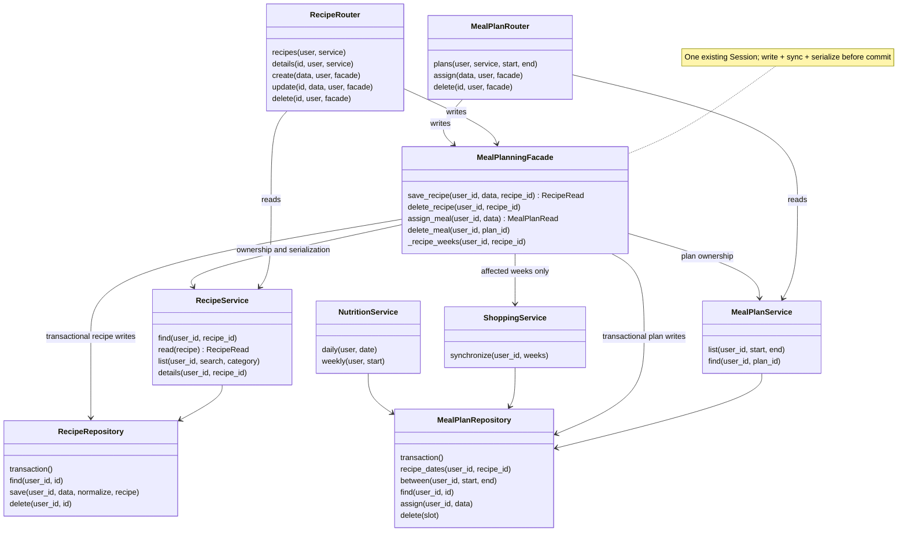
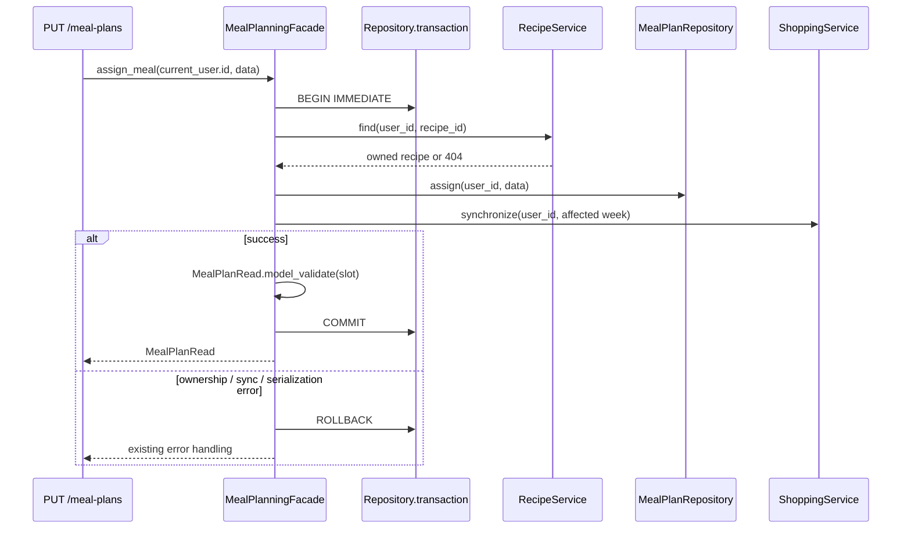

# Архітектура після рефакторингу

Впроваджено один новий патерн **Facade** — `backend/app/services/meal_planning_facade.py`, клас `MealPlanningFacade`. Проста публічна поверхня охоплює чотири сценарії, а не CRUD усього застосунку:

- `save_recipe(user_id, data, recipe_id=None)`: транзакція → власник і зачеплені тижні (лише редагування) → запис → синхронізація → RecipeRead → commit.
- `delete_recipe`: транзакція → власник → тижні до каскадного видалення → видалення → синхронізація → commit.
- `assign_meal`: транзакція → власник рецепта → створення/заміна слота → синхронізація тижня → MealPlanRead → commit.
- `delete_meal`: транзакція → власник слота → тиждень до видалення → видалення → синхронізація → commit.

Приватний `_recipe_weeks` прибирає повтор побудови унікального набору тижнів. Для створення рецепта дати плану не читаються. Фасад використовує наявні Repository та ShoppingService; алгоритм синхронізації не копіюється.

`RecipeService` залишає читання, перевірку власника і перетворення у DTO; залежить лише від RecipeRepository. `MealPlanService` залишає читання діапазону й `find` з перевіркою власника; залежить лише від MealPlanRepository. Методи запису перенесені до фасаду, старих паралельних точок запису в сервісах не залишено.

`app/dependencies.py`: `get_meal_planning_facade` отримує три компоненти через Depends; кеш залежностей FastAPI зберігає спільні репозиторії/Session. Маршрути GET використовують попередні читальні сервіси. POST/PUT/DELETE рецептів та PUT/DELETE плану отримують Facade. Pydantic-валідація та current_user залишаються на HTTP-межі.

Транзакції, BEGIN IMMEDIATE, rollback/commit, порядок SQL/перевірок і формати DTO збережені. Міграції, ORM, JSON-схеми, формули калорій/порцій та Flutter-код не змінені. Статистика читає актуальний план; зайвого перерахунку статистики при записі не додано.

## Файли

Створено: `backend/app/services/meal_planning_facade.py`, `backend/tests/test_meal_planning_facade.py`, матеріали `docs/lab12/`.

Змінено: `backend/app/services/recipe_service.py`, `backend/app/services/meal_plan_service.py`, `backend/app/dependencies.py`, `backend/app/routers/recipes.py`, `backend/app/routers/meal_plans.py`.

Наявні тести, репозиторії, алгоритми покупок/калорій, авторизація й Flutter не змінені.

UML класів: [after_facade.mmd](after_facade.mmd). Взаємодія: [facade_sequence.mmd](facade_sequence.mmd). Інтерфейс фасаду — його чотири публічні методи; окремий абстрактний інтерфейс без альтернативних реалізацій не створювався.

