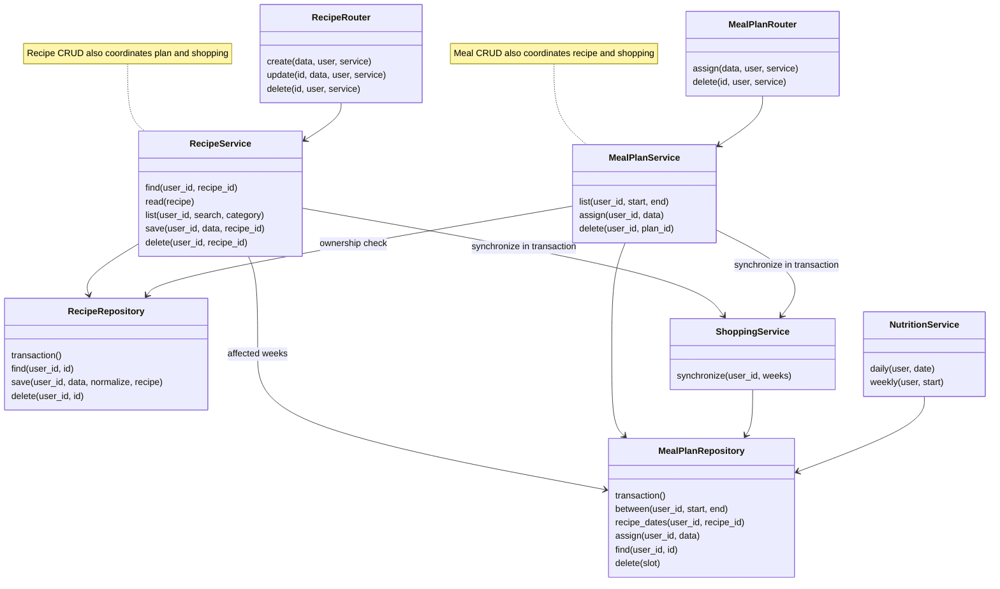

# Архітектура до рефакторингу

Контрольна версія: `1145e1f` (`Change`), початкова гілка `main`, робоча копія чиста. Для ЛР №12 створено `lab12-design-patterns`. UML: [before.mmd](before.mmd).

## Наявні шари та патерни

Flutter: `lib/screens/` і `lib/widgets/` → `lib/services/` → контракти `lib/repositories/` і реалізації `lib/data/repositories/` → `lib/data/api/api_client.dart`. API DTO відокремлені від UI. Локальні демонстраційні реалізації не є резервним джерелом при мережевій помилці. `ServerController.refresh/mutate/_reload` уже координує серверні кеші рецептів, плану, покупок і статистики: фактично Facade/координатор. `ChangeNotifier` реалізує сповіщення Observer. Repository, Dependency Injection та адаптація серверних реалізацій уже використовуються.

FastAPI: `app/routers/` → `app/services/` → `app/repositories/` → SQLAlchemy/SQLite. `app/dependencies.py` збирає залежності в межах одного запиту; всі предметні репозиторії отримують ту саму Session. `current_user` перевіряє JWT; ресурси читаються за user_id. Pydantic відповідає за схеми/валідацію, Alembic — за структуру БД.

## Конкретна проблема

- `app/services/recipe_service.py`, `RecipeService.save/delete`: окрім рецептів, отримують дати з MealPlanRepository, визначають тижні, відкривають транзакцію та викликають ShoppingService.synchronize.
- `app/services/meal_plan_service.py`, `MealPlanService.assign/delete`: окрім плану, перевіряють власника рецепта, відкривають транзакцію і запускають ту саму синхронізацію покупок.
- Правило «зміна рецепта/плану та відповідних автоматичних покупок — одна транзакція» розподілено між двома сервісами. RecipeService залежить від трьох компонентів, MealPlanService також від трьох. Побудова набору тижнів рецепта повторена в save/delete.

Це локальна проблема координації, а не причина переписувати весь проєкт. Репозиторії, `Repository.transaction` з BEGIN IMMEDIATE/rollback, валідація та алгоритми залишаються придатними.

## Калорії й покупки

`NutritionService._daily`: ккал рецепта на одну порцію × planned_servings; невідомі ккал зберігають неповний підсумок. `weekly`: усі 7 днів, включно з порожніми. `ShoppingService.synchronize`: інгредієнти × planned_servings / servings, Decimal, сумісні одиниці, окреме «за смаком», збереження ручних покупок і правила придбання. Ці алгоритми не потребують заміни.

## Тести

Наявні suites: backend/tests (auth, API, права, міграції, seed, restart, lab11); Flutter test/ (unit, API, workflow, widget, адаптивність). Початкові результати фактичного прогону збережені в logs/before та test_results.md. Робоча SQLite не використовується як тестова.

